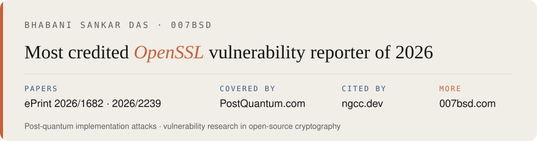

<picture>
  <source media="(prefers-color-scheme: dark)" srcset="banner-dark.svg">
  
</picture>

[007bsd.com](https://007bsd.com) · [ePrint 2026/1682](https://eprint.iacr.org/2026/1682) · [ePrint 2026/2239](https://eprint.iacr.org/2026/2239) · [PostQuantum.com coverage](https://007bsd.com/research/#coverage) · [ngcc.dev](https://ngcc.dev/reports/kem-02.html) · [OpenSSL credits](https://openssl-library.org/news/vulnerabilities/)
