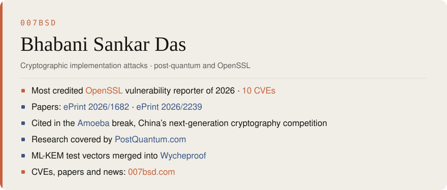

<a href="https://007bsd.com">
<picture>
  <source media="(prefers-color-scheme: dark)" srcset="card4-dark.svg">
  
</picture>
</a>

**Sources:** [007bsd.com](https://007bsd.com) · [OpenSSL credits](https://openssl-library.org/news/vulnerabilities/) · [ePrint 2026/1682](https://eprint.iacr.org/2026/1682) · [ePrint 2026/2239](https://eprint.iacr.org/2026/2239) · [Amoeba break](https://007bsd.com/research/#citations) · [PostQuantum.com](https://007bsd.com/research/#coverage) · [Wycheproof](https://github.com/C2SP/wycheproof/pull/274)
